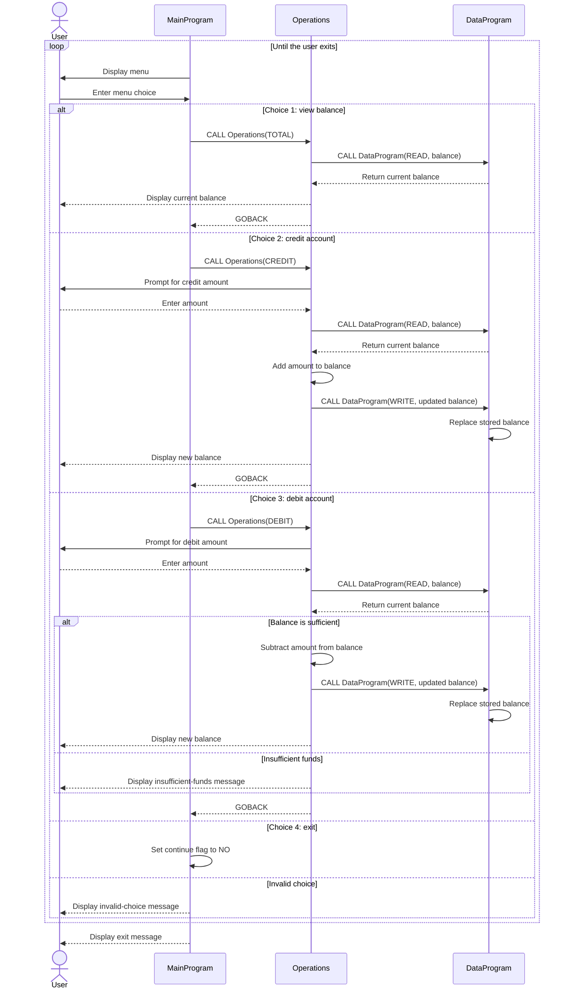

# School Accounting System: Code Findings

## Overview

The COBOL source implements a small, interactive account-balance manager. It can display one balance, credit it, debit it when sufficient funds are available, and exit. Although this could be a starting point for a school accounting system, the current program does not model students, families, tuition, fees, invoices, or a transaction history.

## Program Responsibilities

### `main.cob` - Menu and program flow

`MainProgram` displays the account-management menu, accepts the user's choice, and dispatches the request to `Operations`:

- Choice 1 requests a balance view (`TOTAL`, padded to six characters).
- Choice 2 requests a credit (`CREDIT`).
- Choice 3 requests a debit (`DEBIT`, padded to six characters).
- Choice 4 ends the menu loop and exits.
- Other choices display an invalid-choice message.

### `operations.cob` - Account operations and rules

`Operations` handles the requested operation and prompts for an amount when needed:

- `TOTAL` reads and displays the current balance. The operation value is padded to six characters.
- `CREDIT` reads the amount, adds it to the balance, writes the result, and displays the new balance.
- `DEBIT` reads the amount and subtracts it only if the balance is greater than or equal to that amount. The operation value is padded to six characters. Otherwise, the program displays an insufficient-funds message and leaves the balance unchanged.

### `data.cob` - Balance access

`DataProgram` responds to `READ` by copying its stored balance to the caller, and to `WRITE` by replacing the stored balance with the caller's value. The initial balance is `1000.00`. This is program working storage; the code does not read or write a file or database, so it does not provide durable accounting records.

## Implemented Business Requirements

The behavior currently present in the code implies these requirements:

1. A user can view the current account balance.
2. A user can credit an entered amount to the account.
3. A user can debit an entered amount only when enough balance is available.
4. The system reports an insufficient-funds condition rather than applying an unaffordable debit.
5. A user can exit the account-management menu.

## Important Gaps for School Accounting

These are not implemented and would need requirements and design before the program could support school accounting workflows:

- Separate accounts and balances for students, families, departments, or funds.
- Identifying a payer or student and associating transactions with the correct account.
- Tuition, fee, discounts, waivers, refunds, payment plans, and due dates.
- A transaction ledger with dates, references, descriptions, and audit history.
- Persistent storage and recovery across program runs.
- Input validation, including rejecting negative amounts and handling invalid numeric input.
- Currency formatting, precision rules, authorization, and reconciliation controls.

## Call Flow

`MainProgram` accepts a menu choice and calls `Operations`. `Operations` applies the requested action and calls `DataProgram` to read or update the balance. `DataProgram` is the only component that owns the stored balance.

The balance fields use `PIC 9(6)V99`: six integer digits and two fractional digits, with an implied decimal point.

## Sequence Diagram

